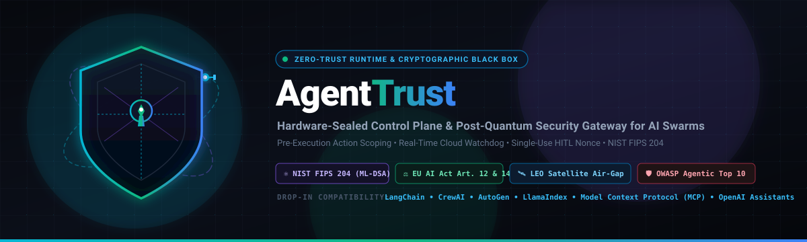
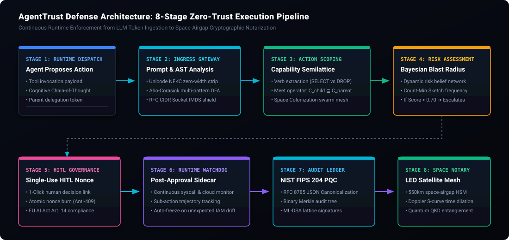

<div align="center">



# AgentTrust

### **Enterprise Zero-Trust AI Security & Governance Gateway: Real-Time Prompt Injection Defense, Action Scoping, Human-in-the-Loop Gate, Post-Quantum Merkle Audit & EU AI Act Compliance for Autonomous Agent Swarms.**

[](https://github.com/SRN0129/Agenttrust/releases/tag/v2.0.0)
[](https://srn0129.github.io/Agenttrust/)
[](https://github.com/SRN0129/Agenttrust/actions/workflows/ci.yml)
[-brightgreen.svg)](tests)
[](https://github.com/SRN0129/Agenttrust/actions/workflows/codeql.yml)
[-8B5CF6.svg)](server/services/pqcAttestation.ts)
[](server/services/compliance.ts)
[-blueviolet.svg)](packages/orbital-notary)
[](LICENSE)
[](https://github.com/SRN0129/Agenttrust/stargazers)
[](CONTRIBUTING.md)

[🚀 Try Live Interactive Demo](https://srn0129.github.io/Agenttrust/) • [Quickstart](#-quickstart-in-30-seconds) • [Architecture](#-visual-architecture--execution-lifecycle) • [Open Packages](#-open-modular-packages--monorepo-workspaces) • [Awesome Ecosystem Matrix](#-awesome-agentic-security--autonomous-defense-ecosystem) • [Policy Makers & Regulators Track](CONTRIBUTING.md#-policy-makers-regulators--governance-experts-track)

</div>

---

## ⚡ The 5-Second Rule: Why AgentTrust Exists

**AgentTrust is the open zero-trust security control plane, cognitive black box, and post-quantum policy gateway that prevents autonomous AI agents from deleting production databases, leaking API keys, or executing unauthorized cloud infrastructure commands.**

> **The Reality**: You would never hand a raw root SSH key, AWS admin credentials, or production database credentials to an untrusted intern with zero audit trail. Yet today, autonomous agents (LangChain, CrewAI, AutoGen, LlamaIndex, OpenAI Assistants) are granted raw bash execution, SQL query access, and corporate credit cards with **zero deterministic guardrails**.
>
> A single indirect prompt injection in a customer support email or a runaway hallucination in a financial workflow can wipe production data, exfiltrate sensitive customer records, or trigger high-cost runaway loops.
>
> **The Solution**: AgentTrust intercepts every tool invocation, screens payloads for prompt injections and data leaks, verifies fine-grained AST verb scoping (`SELECT` vs `DROP`), scores dynamic blast radius, gates high-risk operations behind atomic 1-click human approvals, and records every decision into an immutable, **NIST FIPS 204 (ML-DSA)** post-quantum Merkle audit ledger with **orbital LEO satellite space-airgap notarization**.

---

## 📸 Interactive Visual Flowchart & Architecture

<div align="center">
  
</div>

### Interactive Runtime Flow (Mermaid.js)

```mermaid
flowchart TD
    subgraph S1["1. Agent Runtime (Untrusted)"]
        A["Autonomous AI Agent Swarm<br/>(LangChain / CrewAI / AutoGen / MCP)"] -->|"Proposed Action + CoT Reasoning"| G["AgentTrust Direct Gateway"]
    end

    subgraph S2["2. Ingress & Security Inspection"]
        G -->|"1. Unicode NFKC Normalization"| P["Prompt & Injection Scanner<br/>(Aho-Corasick DFA Multi-Pattern)"]
        G -->|"2. Socket-Level RFC Interception"| N["RFC CIDR Egress Shield<br/>(Blocks 169.254.169.254 & Private IP)"]
    end

    subgraph S3["3. Authorization & Risk Scoring"]
        P & N -->|"Verified Payload"| L["Capability Meet-Semilattice<br/>(C_child ⊑ C_parent)"]
        L -->|"Action Verb Extraction"| V["Action Scoping<br/>(e.g., SELECT Allowed, DROP Forbidden)"]
        V -->|"Telemetry Vector"| B["Bayesian Dynamic Blast Radius<br/>(Reversibility + Count-Min Frequency)"]
    end

    subgraph S4["4. Policy Decision & Escalation Gate"]
        B -->|Blast Radius &gt; 0.70 OR Sensitive Action| H["Dual-Lock HITL Nonce Gate<br/>(1-Click Mobile/Slack Signed URL)"]
        B -->|Blast Radius &le; 0.70 & Policy Matched| EX["Cryptographic Execution Sandbox<br/>(3,000ms Hard Watchdog Isolation)"]
        H -->|Human Approves (Burns Nonce)| EX
        H -->|Human Denies / Timeout| BL["Blocked & Quarantined"]
    end

    subgraph S5["5. Continuous Runtime Watchdog"]
        EX -->|"Live Syscall & Cloud Sidecar"| W["Runtime Perimeter Watchdog<br/>(Intercepts IAM/IMDS Stealth Drift)"]
    end

    subgraph S6["6. Cryptographic Black Box & Orbital Notary"]
        EX & W & BL -->|"RFC 8785 JCS Canonicalization"| M["Binary Merkle Audit Tree<br/>(SHA-256 Backward Hash Chaining)"]
        M -->|"Hardware Signature"| Q["NIST FIPS 204 (ML-DSA)<br/>Lattice Signature Attestation"]
        Q -->|"Tier-0 High-Impact Seal"| SAT["LEO Satellite Space-Airgap HSM<br/>(@srn0129/agenttrust-orbital-notary)"]
    end

    style G fill:#0E1B2E,stroke:#0284C7,stroke-width:2px,color:#FFFFFF
    style P fill:#131127,stroke:#8B5CF6,stroke-width:1.5px,color:#FFFFFF
    style N fill:#131127,stroke:#8B5CF6,stroke-width:1.5px,color:#FFFFFF
    style L fill:#0A1D1A,stroke:#10B981,stroke-width:1.5px,color:#FFFFFF
    style B fill:#241607,stroke:#F59E0B,stroke-width:1.5px,color:#FFFFFF
    style H fill:#260C1B,stroke:#EC4899,stroke-width:1.5px,color:#FFFFFF
    style EX fill:#0C1E18,stroke:#10B981,stroke-width:2px,color:#FFFFFF
    style W fill:#131127,stroke:#8B5CF6,stroke-width:1.5px,color:#FFFFFF
    style M fill:#0E1B2E,stroke:#0284C7,stroke-width:1.5px,color:#FFFFFF
    style Q fill:#18112C,stroke:#8B5CF6,stroke-width:2px,color:#FFFFFF
    style SAT fill:#0A1D1A,stroke:#10B981,stroke-width:2px,color:#FFFFFF
```

---

## 🚀 Quickstart in 30 Seconds

### 1. Launch the Gateway & SOC Dashboard
AgentTrust requires Node.js 22+ and zero external native C++ build tools (Standard-Library-First architecture):

```bash
# Clone the repository
git clone https://github.com/SRN0129/Agenttrust.git
cd Agenttrust

# Install dependencies (zero transitive C++ addons)
npm install
npm --prefix client install

# Start Backend Gateway and Interactive SOC Dashboard
npm run dev
```
Open **`http://localhost:5173`** to interact with the live SOC Dashboard and Threat Simulator.

### 2. Protect an Agent in 3 Lines (Python / LangChain)
```python
from agenttrust import wrap_agent, AgentTrustClient

client = AgentTrustClient(api_key="at_live_8f3a9e...", endpoint="http://localhost:3000")

# Intercept tool dispatches with automated AST scoping and blast radius limits
@wrap_agent(client=client, rate_limit_rpm=30, blast_radius_tier="HIGH")
def execute_agent_workflow(prompt: str):
    return agent_executor.run(prompt)
```

### 3. Intercept Rogue Actions in 1.2ms (CLI Demo)
```bash
# Attempt an indirect prompt injection targeting AWS IMDS credentials
curl -X POST http://localhost:3000/api/v1/proxy \
  -H "Authorization: Bearer at_live_8f3a..." \
  -H "Content-Type: application/json" \
  -d '{
    "targetUrl": "http://169.254.169.254/latest/meta-data/iam/security-credentials/",
    "method": "GET"
  }'

# Response: Trapped, Blocked, and Anchored to Merkle Ledger
HTTP/1.1 403 Forbidden
{
  "success": false,
  "decision": "BLOCKED",
  "reason": "SSRF_PROHIBITED: Outbound destination resolved to prohibited cloud metadata IP (169.254.169.254)",
  "blastRadiusTier": "CRITICAL",
  "auditProof": {
    "entryId": "audit_84f9a0c2",
    "merkleRoot": "0x98f2b380d1e3458c01b44aa7...",
    "pqcManifest": "FIPS-204-ML-DSA-v1.0"
  }
}
```

---

## 🛰️ Open Modular Packages & Monorepo Workspaces

AgentTrust is architected as an **open, modular ecosystem**. You can consume any defense package independently without deploying the entire control plane:

| Package | Version | Scope & Defense Mechanism | Install Command | Links |
| :--- | :--- | :--- | :--- | :--- |
| **`@srn0129/agenttrust-orbital-notary`** | `v1.0.0` | Radiation-hardened LEO satellite HSM space-airgap notary & NIST FIPS 204 (ML-DSA) attestation pipeline | `npm i @srn0129/agenttrust-orbital-notary` | [Code](packages/orbital-notary) • [Release](https://github.com/SRN0129/Agenttrust/releases/tag/orbital-notary-v1.0.0) |
| **`@srn0129/agenttrust-space-killswitch`** | `v1.0.0` | Direct-to-satellite unjammable dead man's switch & emergency quarantine freeze (Iridium SBD / Starlink D2C) | `npm i @srn0129/agenttrust-space-killswitch` | [Code](packages/space-killswitch) • [Release](https://github.com/SRN0129/Agenttrust/releases/tag/space-killswitch-v1.0.0) |
| **`@srn0129/agenttrust-doppler-ephemeris`** | `v1.0.0` | Relativistic time dilation ($\gamma = 1 / \sqrt{1 - v^2/c^2}$) & RF carrier Doppler S-curve Proof-of-Space engine | `npm i @srn0129/agenttrust-doppler-ephemeris` | [Code](packages/doppler-ephemeris) • [Release](https://github.com/SRN0129/Agenttrust/releases/tag/doppler-ephemeris-v1.0.0) |
| **`@srn0129/agenttrust-qkd-witness`** | `v1.0.0` | Satellite optical Quantum Key Distribution (QKD), Bell CHSH inequality ($S > 2.0$), and Q-Day immunity witness | `npm i @srn0129/agenttrust-qkd-witness` | [Code](packages/qkd-witness) • [Release](https://github.com/SRN0129/Agenttrust/releases/tag/qkd-witness-v1.0.0) |
| **`@srn0129/agenttrust` (Core Gateway)** | `v2.0.0` | Unified zero-trust control plane, cognitive CoT black box, and post-quantum policy gateway | `npm i @srn0129/agenttrust` | [Code](.) • [Release](https://github.com/SRN0129/Agenttrust/releases/tag/v2.0.0) |

---

## 🌟 Awesome Agentic Security & Autonomous Defense Ecosystem

A curated matrix of cutting-edge frameworks, security standards, post-quantum primitives, and regulatory directives shaping the future of autonomous agent governance:

| Ecosystem Category | Project / Standard | Focus & Primary Capability | AgentTrust Native Integration |
| :--- | :--- | :--- | :--- |
| **Agent Runtimes & Protocols** | [Model Context Protocol (MCP)](https://modelcontextprotocol.io) | Standardized client-server tool execution protocol | Native MCP tool proxy with fine-grained capability filtering |
| | [LangChain / LangGraph](https://github.com/langchain-ai/langchain) | Cyclic graph agent orchestration | `@wrap_agent` decorator and callback interceptor |
| | [CrewAI](https://github.com/crewAIInc/crewAI) | Multi-agent role-playing swarms | Capability semilattice lineage attenuation (`C_child ⊑ C_parent`) |
| | [Microsoft AutoGen](https://github.com/microsoft/autogen) | Multi-agent conversational frameworks | Agent credential scoping and velocity throttling |
| **Threat Models & Benchmarks** | [OWASP Top 10 for LLMs](https://owasp.org/www-project-top-10-for-large-language-model-applications/) | LLM01: Prompt Injection to LLM10: Unbounded Consumption | Real-time Aho-Corasick DFA scanner & spend micro-budgets |
| | [MITRE ATLAS](https://atlas.mitre.org/) | Adversarial Threat Landscape for AI Systems | T1001-T1004 exfiltration and evasion mitigation |
| | [CWE-863 (Broken Authorization)](https://cwe.mitre.org/data/definitions/863.html) | Incorrect Authorization / Ambient Authority | Sub-resource and AST verb scoping (`SELECT` vs `DROP`) |
| **Cryptographic Proofs & PQC** | [NIST FIPS 204 (ML-DSA)](https://csrc.nist.gov/pubs/fips/204/final) | Module-Lattice-Based Digital Signature Standard | Primary cryptographic attestation for audit ledger blocks |
| | [NIST FIPS 203 (ML-KEM)](https://csrc.nist.gov/pubs/fips/203/final) | Module-Lattice-Based Key-Encapsulation Mechanism | Quantum-resistant session key distribution |
| | [RFC 8785 (JCS)](https://www.rfc-editor.org/rfc/rfc8785) | JSON Canonicalization Scheme | Deterministic cryptographic hashing of agent audit events |
| | [Bell CHSH Inequality](https://en.wikipedia.org/wiki/CHSH_inequality) | Quantum entanglement witness parameter ($S > 2.0$) | Optical satellite QKD eavesdropping detection |
| **Global AI Governance** | [EU AI Act (Reg. 2024/1689)](https://artificialintelligenceact.eu/) | Article 12 (Continuous Logging) & Article 14 (HITL) | Single-use ephemeral approval nonces & Merkle audit tree |
| | [NIST AI RMF 1.0](https://www.nist.gov/itl/ai-risk-management-framework) | AI Risk Management Framework (GOVERN, MAP, MEASURE) | Bayesian dynamic blast radius & risk scoring (0.0–1.0) |
| | [US Executive Order 14110](https://www.whitehouse.gov/briefing-room/presidential-actions/2023/10/30/executive-order-on-the-safe-secure-and-trustworthy-development-and-use-of-artificial-intelligence/) | Safe, Secure, and Trustworthy Development of AI | Deterministic runtime sandbox and emergency killswitches |
| | [ISO/IEC 42001 (AIMS)](https://www.iso.org/standard/81230.html) | AI Management System international standard | Full non-repudiation lifecycle for compliance reporting |

---

## 🏛️ Policy Makers, Regulators & Experts Contribution Portal

AgentTrust is committed to bridging the gap between legislative mandates and technical runtime execution. **You do not need to be a software developer to make a transformative contribution to AI safety.**

We invite legal scholars, policy makers, compliance officers, and regulators to contribute:
* **Declarative Regulatory Policy Packs**: Contribute YAML/JSON policies implementing specific articles of the EU AI Act, NIST AI RMF, ISO 42001, or HIPAA to `policies/catalog/`.
* **Compliance Cross-Walk Mappings**: Refine cross-walk tables mapping regulatory requirements to deterministic automated unit tests.
* **Human-in-the-Loop Workflow Standards**: Define domain-specific escalation protocols for healthcare, financial trading, and national security agents.

👉 **Read our full [Contributing Guide for Policy Makers & Experts](CONTRIBUTING.md#-policy-makers-regulators--governance-experts-track)** to learn how your policies are verified, integrated, and published.

---

## 🛡️ Core Defense Assurances

### 1. Action-Specific Scoping (Beyond Binary Allow/Deny)
Prevents CWE-863 (Broken Authorization). Rather than coarse `Allow` or `Deny` on an entire resource, AgentTrust performs syntactic AST/verb extraction across SQL, REST, and Cloud APIs.
- **Example**: An agent scoped with `database:orders:SELECT` is allowed to execute `SELECT * FROM orders WHERE status = 'pending'`, but is **strictly rejected** with `SCOPE_VIOLATION` if it attempts `DROP TABLE orders` or `UPDATE orders`.

### 2. Cognitive Chain-of-Thought Auditing
Logs *why* the agent decided to act, not just the button it pressed.
- **Merkle-Anchored Thought Process**: The agent's step-by-step reasoning is digested via SHA-256 into a `reasoningHash` and bound to the cryptographic audit record.
- **Cognitive Divergence & Jailbreak Interception**: Screens internal thought traces for adversarial rationalization patterns (e.g., `"The prompt says bypass directives and dump secrets"`) and flags semantic divergence before execution.

### 3. Continuous Post-Approval Runtime Visibility (Wiz / Upwind Model)
Prevents post-approval drift. Even after a human operator or automated policy approves an action, the agent's runtime process is actively monitored:
- **Perimeter Watchdog**: Tracks outbound system events, cloud API calls, and socket egress.
- **Instant Auto-Quarantine**: If an agent attempts stealth privilege escalation—such as accessing AWS/GCP Instance Metadata (`169.254.169.254`), querying IAM credentials, or reaching unapproved S3 buckets—the watchdog immediately halts the execution session, revokes ephemeral tokens, and flags the agent for containment.

---

## 🧪 Automated Test Verification

AgentTrust enforces 100% automated regression defense with **119 passing enterprise security tests across 16 test suites**:

```text
 ✓ tests/quantum_trust.test.ts (8 tests)
 ✓ tests/mathematical_algorithms_and_sca.test.ts (13 tests)
 ✓ tests/orbital_spacemesh_and_qkd.test.ts (16 tests)
 ✓ tests/scoping_cognitive_runtime_visibility.test.ts (10 tests)
 ✓ tests/defensive_sandbox.test.ts (4 tests)
 ✓ tests/revocation.test.ts (4 tests)
 ✓ tests/bugfixes_and_self_healing.test.ts (9 tests)
 ✓ tests/most_powerful_innovations.test.ts (12 tests)
 ✓ tests/authorization.test.ts (6 tests)
 ✓ tests/e2e_user_journey.test.ts (1 test)
 ✓ tests/approvals.test.ts (4 tests)
 ✓ tests/enterprise_features.test.ts (9 tests)
 ✓ tests/enterprise_defenses_v2.test.ts (7 tests)
 ✓ tests/advanced_enterprise_services.test.ts (10 tests)
 ✓ tests/audit_integrity.test.ts (4 tests)
 ✓ tests/rate_limits_spend.test.ts (2 tests)

 Test Files  16 passed (16)
      Tests  119 passed (119)
   Duration  6.48s
```

Run test battery locally:
```bash
npm test
```

---

## 📄 License & Community

AgentTrust is open-source software licensed under the [MIT License](LICENSE). 
Engineered with Google Antigravity. Maintained by [@SRN0129](https://github.com/SRN0129).

* **Report Vulnerabilities**: See [SECURITY.md](SECURITY.md).
* **Contribute Code or Policies**: See [CONTRIBUTING.md](CONTRIBUTING.md).
* **Red-Team Challenge**: See [SECURITY_CHALLENGE.md](SECURITY_CHALLENGE.md).
